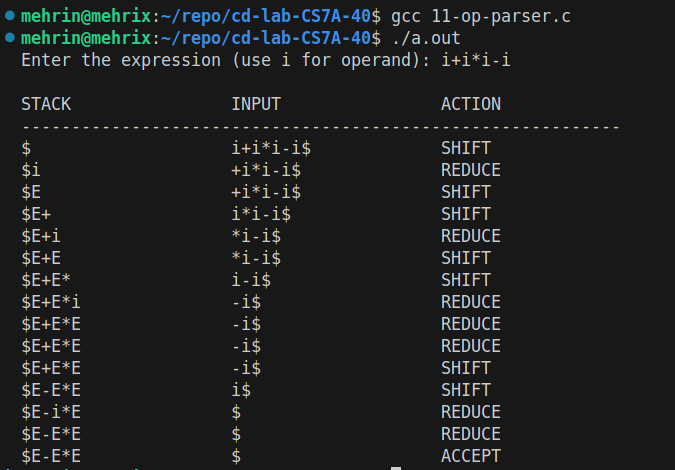

# CD Lab Exp 11

## Aim

To write a C program to implement an operator precedence parser for expressions over the operators +, -, *, / and the operand i.

## Algorithm

1. Start.
2. Read the expression (i denotes an operand) and append `$` as the end marker.
3. Initialise the stack with `$`.
4. Repeat:
    - 4.1 Let `a` be the topmost terminal on the stack and `b` the current input symbol.
    - 4.2 If both `a` and `b` are `$`, display ACCEPT and stop.
    - 4.3 Find the precedence relation between `a` and `b`.
    - 4.4 If `a` has lower precedence (`<`) or equal precedence (`=`), SHIFT: push `b` on the stack and advance the input pointer.
    - 4.5 If `a` has higher precedence (`>`), REDUCE: replace `i` by `E`, or `E op E` by `E`. If no handle is found, report an error.
    - 4.6 If there is no relation between `a` and `b`, report an error and stop.
5. Display the stack, the remaining input and the action at every step.
6. Stop.

## Program

```c
#include <stdio.h>
#include <string.h>
#define MAX 100
char stack[MAX];
int top = -1;
void push(char c)
{
stack[++top] = c;
}
char pop()
{
return stack[top--];
}
char topTerminal()
{
int i;
for (i = top; i >= 0; i--)
{
if (stack[i] == 'i' ||
stack[i] == '+' ||
stack[i] == '-' ||
stack[i] == '*' ||
stack[i] == '/' ||
stack[i] == '$')
return stack[i];
}
return '$';
}

int precedence(char a, char b)
{
/*
Returns:
'<' shift
'>' reduce
'=' equal precedence
' ' invalid
*/
if (a == '$' && b == '$')
return '=';
if (a == '$')
return '<';
if (b == '$')
return '>';
if (a == 'i')
{
if (b == 'i')
return ' ';
else
return '>';
}
if (b == 'i')
return '<';
if (a == '+' || a == '-')
{
if (b == '+' || b == '-')
return '>';
if (b == '*' || b == '/')
return '<';
}
if (a == '*' || a == '/')
{
if (b == '+' || b == '-')
return '>';
if (b == '*' || b == '/')
return '>';
}
return ' ';
}
void displayStack()
{
int i;
for (i = 0; i <= top; i++)
printf("%c", stack[i]);
}

int reduce()
{
/*
Valid handles:
i
E+E
E-E
E*E
E/E
Since the stack stores only symbols, i is treated
as an operand and operators represent E op E.
*/
if (top >= 0 && stack[top] == 'i')
{
stack[top] = 'E';
return 1;
}
if (top >= 2 &&
stack[top - 2] == 'E' &&
(stack[top - 1] == '+' ||
stack[top - 1] == '-' ||
stack[top - 1] == '*' ||
stack[top - 1] == '/') &&
stack[top] == 'E')
{
top -= 2;
stack[top] = 'E';
return 1;
}
return 0;
}
int main()
{
char input[MAX];
int ip = 0;
char a, b;
char rel;
printf("Enter the expression (use i for operand): ");
scanf("%s", input);
strcat(input, "$");
top = 0;
stack[0] = '$';
printf("\n%-20s %-20s %-20s\n",
"STACK", "INPUT", "ACTION");
printf("------------------------------------------------------------\n");
while (1)
{

a = topTerminal();
b = input[ip];
if (a == '$' && b == '$')
{
printf("%-20s %-20s ACCEPT\n",
stack, input + ip);
break;
}
rel = precedence(a, b);
printf("%-20s %-20s ",
stack, input + ip);
if (rel == '<' || rel == '=')
{
push(b);
ip++;
if (rel == '<')
printf("SHIFT\n");
else
printf("SHIFT\n");
}
else if (rel == '>')
{
if (reduce())
printf("REDUCE\n");
else
{
printf("ERROR\n");
break;
}
}
else
{
printf("ERROR\n");
break;
}
}
return 0;
}
```

## Output


