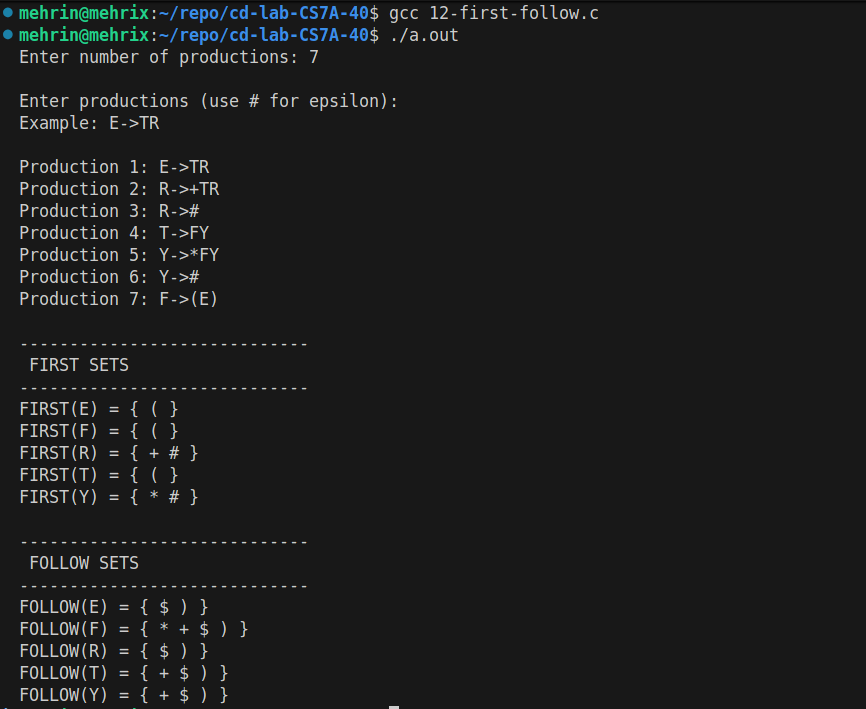

# CD Lab Exp 12

## Aim

To write a C program to simulate the computation of FIRST and FOLLOW sets of any given grammar.

## Algorithm

1. Start.
2. Read the number of productions and the productions (upper-case letters are non-terminals, `#` denotes epsilon). The LHS of the first production is the start symbol.
3. Compute FIRST:
    - 3.1 For each production `A->X1X2...Xn`, add FIRST(X1) (except `#`) to FIRST(A).
    - 3.2 If X1 derives `#`, continue with X2, and so on; if every Xi derives `#`, add `#` to FIRST(A).
    - 3.3 If X1 is a terminal, add X1 to FIRST(A).
    - 3.4 Repeat step 3 until no FIRST set changes.
4. Compute FOLLOW:
    - 4.1 Add `$` to FOLLOW(start symbol).
    - 4.2 For each production `A->αBβ`, add FIRST(β) (except `#`) to FOLLOW(B).
    - 4.3 If β is empty or FIRST(β) contains `#`, add FOLLOW(A) to FOLLOW(B).
    - 4.4 Repeat step 4 until no FOLLOW set changes.
5. Display the FIRST and FOLLOW set of every non-terminal.
6. Stop.

## Program

```c
#include <stdio.h>
#include <string.h>
#include <ctype.h>

#define MAX 20
#define MAXLEN 100

char productions[MAX][MAXLEN];
char first[26][MAX];
char follow[26][MAX];

int n;
char startSymbol;

/* Add a character to a set if it is not already present */
int addToSet(char set[], char c)
{
int i;

for (i = 0; set[i] != '\0'; i++)
{
if (set[i] == c)
return 0;
}

set[i] = c;
set[i + 1] = '\0';

return 1;
}

/* Check whether symbol is a non-terminal */
int isNonTerminal(char c)
{
return (c >= 'A' && c <= 'Z');
}

/* Calculate FIRST of a string */
int firstOfString(char str[], char result[])
{
int i;
int changed = 0;
int nullable = 1;

result[0] = '\0';

for (i = 0; str[i] != '\0'; i++)
{
char symbol = str[i];

if (symbol == ' ')
continue;

/* Terminal */
if (!isNonTerminal(symbol))
{

if (symbol == '#')
{
addToSet(result, '#');
return changed;
}

if (addToSet(result, symbol))
changed = 1;

nullable = 0;
break;
}

/* Non-terminal */
{
int j;
int hasEpsilon = 0;

for (j = 0; first[symbol - 'A'][j] != '\0'; j++)
{
char c = first[symbol - 'A'][j];

if (c == '#')
hasEpsilon = 1;
else
{
if (addToSet(result, c))
changed = 1;
}
}

if (!hasEpsilon)
{
nullable = 0;
break;
}
}

}

if (nullable)
{
if (addToSet(result, '#'))
changed = 1;
}

return changed;
}

/* Calculate FIRST sets */
void calculateFirst()
{
int changed = 1;

while (changed)
{
int i;
changed = 0;

for (i = 0; i < n; i++)
{
char lhs = productions[i][0];
char *rhs = strchr(productions[i], '>');

if (rhs != NULL)
{
rhs++;

while (*rhs == ' ')
rhs++;

{
char temp[MAXLEN];

firstOfString(rhs, temp);

{
int j;

for (j = 0; temp[j] != '\0'; j++)
{
if (addToSet(first[lhs - 'A'], temp[j]))
changed = 1;
}
}
}
}
}
}
}

/* Calculate FOLLOW sets */
void calculateFollow()
{
int changed = 1;

/* $ is added to FOLLOW(start symbol) */
addToSet(follow[startSymbol - 'A'], '$');

while (changed)
{
int i;
changed = 0;

for (i = 0; i < n; i++)
{
char lhs = productions[i][0];
char *rhsPtr = strchr(productions[i], '>');

if (rhsPtr == NULL)
continue;

rhsPtr++;

{
char rhs[MAXLEN];
strcpy(rhs, rhsPtr);

int len = strlen(rhs);
int j;

for (j = 0; j < len; j++)
{
char B = rhs[j];

if (B == ' ')
continue;

if (!isNonTerminal(B))
continue;

/* Find the remaining string after B */
{
char beta[MAXLEN];
int k = 0;
int p;

for (p = j + 1; p < len; p++)
{
if (rhs[p] != ' ')
beta[k++] = rhs[p];
}

beta[k] = '\0';

/* Find FIRST(beta) */
if (beta[0] != '\0')
{
char temp[MAXLEN];

firstOfString(beta, temp);

for (p = 0; temp[p] != '\0'; p++)
{
if (temp[p] != '#')
{
if (addToSet(follow[B - 'A'], temp[p]))
changed = 1;
}
}

/* If beta contains epsilon */
if (strchr(temp, '#') != NULL)
{
int q;

for (q = 0;
follow[lhs - 'A'][q] != '\0';
q++)
{
if (addToSet(follow[B - 'A'],
follow[lhs - 'A'][q]))
changed = 1;
}
}
}
else
{
/* B is at the end of production */
int q;

for (q = 0;
follow[lhs - 'A'][q] != '\0';
q++)
{
if (addToSet(follow[B - 'A'],

follow[lhs - 'A'][q]))
changed = 1;
}
}
}
}
}
}
}
}

int main()
{
int i;

printf("Enter number of productions: ");
scanf("%d", &n);

printf("\nEnter productions (use # for epsilon):\n");
printf("Example: E->TR\n\n");

for (i = 0; i < n; i++)
{
printf("Production %d: ", i + 1);
scanf("%s", productions[i]);
}

startSymbol = productions[0][0];

calculateFirst();
calculateFollow();

printf("\n-----------------------------\n");
printf(" FIRST SETS\n");
printf("-----------------------------\n");

for (i = 0; i < 26; i++)

{
if (first[i][0] != '\0')
{
printf("FIRST(%c) = { ", 'A' + i);

for (int j = 0; first[i][j] != '\0'; j++)
{
printf("%c ", first[i][j]);
}

printf("}\n");
}
}

printf("\n-----------------------------\n");
printf(" FOLLOW SETS\n");
printf("-----------------------------\n");

for (i = 0; i < 26; i++)
{
if (follow[i][0] != '\0')
{
printf("FOLLOW(%c) = { ", 'A' + i);

for (int j = 0; follow[i][j] != '\0'; j++)
{
printf("%c ", follow[i][j]);
}

printf("}\n");
}
}

return 0;
}
```

## Output


