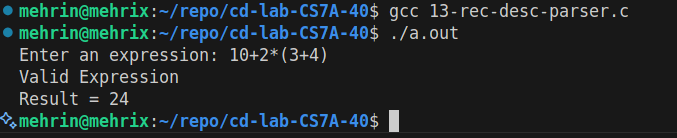

# CD Lab Exp 13

## Aim

To write a C program to construct a recursive descent parser for an arithmetic expression.

## Algorithm

1. Start.
2. Consider the grammar (after removing left recursion):
    - E -> T E'
    - E' -> + T E' | - T E' | ε
    - T -> F T'
    - T' -> * F T' | / F T' | ε
    - F -> ( E ) | number
3. Read the expression into the input buffer and set the position to 0.
4. Write one function for each non-terminal:
    - 4.1 `expression()` calls `term()`, then while the next symbol is `+` or `-`, consumes it and calls `term()` again.
    - 4.2 `term()` calls `factor()`, then while the next symbol is `*` or `/`, consumes it and calls `factor()` again.
    - 4.3 `factor()` skips spaces; if the symbol is `(`, consumes it, calls `expression()` and expects `)`; if it is a digit, reads the whole number; otherwise reports an error.
5. Call `expression()` for the start symbol.
6. If the whole input is consumed, display "Valid Expression" with the computed result; otherwise report a syntax error.
7. Stop.

## Program

```c
#include <stdio.h>
#include <stdlib.h>
#include <ctype.h>
char input[100];
int pos = 0;
/*
Grammar:
E -> T E'
E' -> + T E' | - T E' | epsilon
T -> F T'
T' -> * F T' | / F T' | epsilon
F -> ( E ) | number
*/
void error()
{
printf("Syntax Error at position %d\n", pos);
exit(1);
}
/* Function prototypes */
int expression();
int term();
int factor();
/* E -> T { (+|-) T } */
int expression()
{
int value = term();
while (input[pos] == '+' || input[pos] == '-')
{
char op = input[pos++];
int value2 = term();
if (op == '+')

value = value + value2;
else
value = value - value2;
}
return value;
}
/* T -> F { (*|/) F } */
int term()
{
int value = factor();
while (input[pos] == '*' || input[pos] == '/')
{
char op = input[pos++];
int value2 = factor();
if (op == '*')
{
value = value * value2;
}
else
{
if (value2 == 0)
error();
value = value / value2;
}
}
return value;
}
/* F -> (E) | number */
int factor()
{
int value = 0;
/* Ignore spaces */
while (isspace(input[pos]))
pos++;
/* Case: ( E ) */
if (input[pos] == '(')
{
pos++; // consume '('
value = expression();
if (input[pos] != ')')
error();
pos++; // consume ')'
}
/* Case: number */
else if (isdigit(input[pos]))
{
while (isdigit(input[pos]))
{
value = value * 10 + (input[pos] - '0');
pos++;
}
}
else

{
error();
}
return value;
}
int main()
{
printf("Enter an expression: ");
fgets(input, sizeof(input), stdin);
pos = 0;
int result = expression();
/* Ignore trailing spaces */
while (isspace(input[pos]))
pos++;
/* Input should be completely consumed */
if (input[pos] != '\0')
error();
printf("Valid Expression\n");
printf("Result = %d\n", result);
return 0;
}
```

## Output


