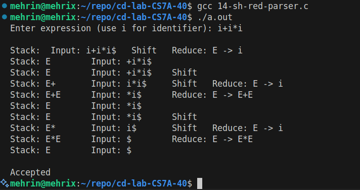

# CD Lab Exp 14

## Aim

To write a C program to implement a shift reduce parser for the grammar E -> E+E | E-E | E*E | E/E | (E) | i.

## Algorithm

1. Start.
2. Read the expression (i denotes an identifier) and append `$` as the end marker.
3. Initialise an empty stack.
4. Repeat:
    - 4.1 Display the stack and the remaining input.
    - 4.2 If the input is not exhausted, SHIFT the next input symbol on to the stack.
    - 4.3 While the top of the stack matches the right side of a production (`i`, `E+E`, `E-E`, `E*E`, `E/E` or `(E)`), REDUCE it to `E` and display the stack.
    - 4.4 If the input is exhausted and the stack contains only `E`, display "Accepted" and stop.
    - 4.5 If the input is exhausted and the stack is not just `E`, display "Rejected" and stop.
5. Stop.

## Program

```c
#include <stdio.h>
#include <string.h>
char stack[100], input[100];
int top = -1;
int ip = 0;
void display()
{
int i;
printf("\nStack: ");
for(i = 0; i <= top; i++)
printf("%c", stack[i]);
printf("\tInput: %s", input + ip);
}

int reduce()
{
if(top >= 0 && stack[top] == 'i')
{
stack[top] = 'E';
printf("\tReduce: E -> i");
return 1;
}
if(top >= 2 &&
stack[top-2] == 'E' &&
stack[top-1] == '+' &&
stack[top] == 'E')
{
top -= 2;
stack[top] = 'E';
printf("\tReduce: E -> E+E");
return 1;
}
if(top >= 2 &&
stack[top-2] == 'E' &&
stack[top-1] == '-' &&
stack[top] == 'E')
{
top -= 2;
stack[top] = 'E';
printf("\tReduce: E -> E-E");
return 1;
}
if(top >= 2 &&
stack[top-2] == 'E' &&
stack[top-1] == '*' &&
stack[top] == 'E')
{
top -= 2;
stack[top] = 'E';
printf("\tReduce: E -> E*E");
return 1;
}
if(top >= 2 &&
stack[top-2] == 'E' &&
stack[top-1] == '/' &&
stack[top] == 'E')
{
top -= 2;

stack[top] = 'E';
printf("\tReduce: E -> E/E");
return 1;
}
if(top >= 2 &&
stack[top-2] == '(' &&
stack[top-1] == 'E' &&
stack[top] == ')')
{
top -= 2;
stack[top] = 'E';
printf("\tReduce: E -> (E)");
return 1;
}
return 0;
}
int main()
{
printf("Enter expression (use i for identifier): ");
scanf("%s", input);
strcat(input, "$");
while(1)
{
display();
if(input[ip] != '$')
{
stack[++top] = input[ip++];
printf("\tShift");
}
while(reduce())
{
display();
}
if(input[ip] == '$' &&
top == 0 &&
stack[top] == 'E')
{
printf("\n\nAccepted\n");
break;
}
if(input[ip] == '$')
{
printf("\n\nRejected\n");

break;
}
}
return 0;
}
```

## Output


