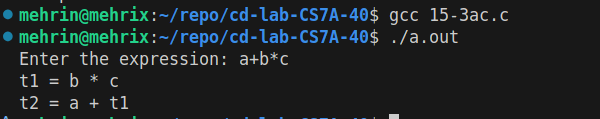

# CD Lab Exp 15

## Aim

To write a C program to generate three address code for simple arithmetic expressions.

## Algorithm

1. Start.
2. Read the infix expression.
3. Create an operator stack and an operand stack, and set the temporary counter to 1.
4. Scan the expression from left to right:
    - 4.1 If the symbol is an operand, push it on the operand stack.
    - 4.2 If the symbol is `(`, push it on the operator stack.
    - 4.3 If the symbol is `)`, generate code for operators until `(` is found, then pop `(`.
    - 4.4 If the symbol is an operator, while the operator on top of the stack has precedence greater than or equal to the current one, generate code; then push the current operator.
5. After the scan, generate code for all remaining operators on the stack.
6. To generate code: pop one operator and two operands, create a new temporary `tN`, print `tN = operand1 op operand2` and push `tN` on the operand stack.
7. Stop.

## Program

```c
#include <stdio.h>
#include <string.h>
#include <ctype.h>
#define MAX 100
char operatorStack[MAX];
int top = -1;
char operandStack[MAX][10];
int operandTop = -1;
int tempCount = 1;
int precedence(char op)
{
if (op == '*' || op == '/')
return 2;
else if (op == '+' || op == '-')

return 1;
else
return 0;
}
void generateCode()
{
char op;
char operand1[10], operand2[10], temp[10];
op = operatorStack[top--];
strcpy(operand2, operandStack[operandTop--]);
strcpy(operand1, operandStack[operandTop--]);
sprintf(temp, "t%d", tempCount++);
printf("%s = %s %c %s\n",
temp, operand1, op, operand2);
strcpy(operandStack[++operandTop], temp);
}
int main()
{
char expression[MAX];
printf("Enter the expression: ");
scanf("%s", expression);
for (int i = 0; expression[i] != '\0'; i++)
{
char ch = expression[i];
// If operand
if (isalnum(ch))
{
operandStack[++operandTop][0] = ch;
operandStack[operandTop][1] = '\0';
}

// If opening parenthesis
else if (ch == '(')
{
operatorStack[++top] = ch;
}
// If closing parenthesis
else if (ch == ')')
{
while (top != -1 && operatorStack[top] != '(')
{
generateCode();
}
top--;
}
// If operator
else
{
while (top != -1 &&
operatorStack[top] != '(' &&
precedence(operatorStack[top]) >= precedence(ch))
{
generateCode();
}
operatorStack[++top] = ch;
}
}
// Process remaining operators
while (top != -1)
{
generateCode();
}
return 0;
}
```

## Output


