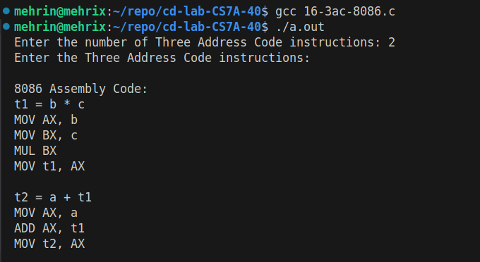

# CD Lab Exp 16

## Aim

To write a C program to convert three address code into 8086 assembly language instructions.

## Algorithm

1. Start.
2. Read the number of three address code instructions.
3. For each instruction of the form `result = operand1 op operand2`, read result, operand1, operator and operand2.
4. Generate 8086 code depending on the operator:
    - 4.1 `+` : `MOV AX, op1`, `ADD AX, op2`, `MOV result, AX`.
    - 4.2 `-` : `MOV AX, op1`, `SUB AX, op2`, `MOV result, AX`.
    - 4.3 `*` : `MOV AX, op1`, `MOV BX, op2`, `MUL BX`, `MOV result, AX`.
    - 4.4 `/` : `MOV AX, op1`, `MOV BX, op2`, `MOV DX, 0000H`, `DIV BX`, `MOV result, AX`.
    - 4.5 Otherwise display "Invalid operator".
5. Repeat steps 3 and 4 for all the instructions.
6. Stop.

## Program

```c
#include <stdio.h>
#include <string.h>
int main()
{
int n, i;
char result[10], operand1[10], operand2[10], op;
printf("Enter the number of Three Address Code instructions: ");
scanf("%d", &n);
printf("Enter the Three Address Code instructions:\n");
printf("\n8086 Assembly Code:\n");
for (i = 0; i < n; i++)
{
scanf("%s = %s %c %s", result, operand1, &op, operand2);
switch (op)
{
case '+':

printf("MOV AX, %s\n", operand1);
printf("ADD AX, %s\n", operand2);
printf("MOV %s, AX\n", result);
break;
case '-':
printf("MOV AX, %s\n", operand1);
printf("SUB AX, %s\n", operand2);
printf("MOV %s, AX\n", result);
break;
case '*':
printf("MOV AX, %s\n", operand1);
printf("MOV BX, %s\n", operand2);
printf("MUL BX\n");
printf("MOV %s, AX\n", result);
break;
case '/':
printf("MOV AX, %s\n", operand1);
printf("MOV BX, %s\n", operand2);
printf("MOV DX, 0000H\n");
printf("DIV BX\n");
printf("MOV %s, AX\n", result);
break;
default:
printf("Invalid operator\n");
}
printf("\n");
}
return 0;
}
```

## Output


